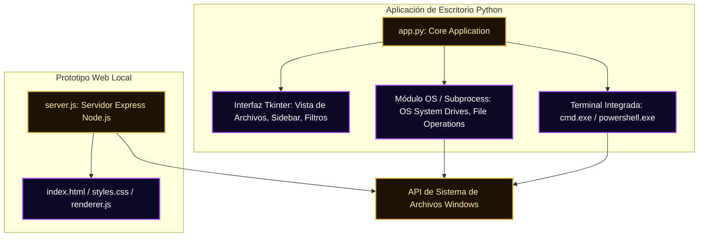

# AureonVault — Explorador de Archivos Experimental

<p align="center">
  
</p>

**AureonVault** es un explorador de files experimental diseñado para el entorno de Windows, que cuenta con una interfaz de escritorio nativa en Python/Tkinter y conserva un prototipo de interfaz web local dentro del mismo repositorio.

El objetivo del proyecto no es reemplazar el Explorador de Windows nativo, sino experimentar con una dirección visual fuertemente estilizada (tonos oscuros, morados y dorados), controles simplificados de navegación, filtros de búsqueda instantáneos y herramientas integradas para terminales del sistema.

---

## 🏗️ Arquitectura Híbrida del Sistema

AureonVault integra dos aproximaciones del mismo problema: una aplicación de escritorio de alto rendimiento basada en Python y un prototipo web desacoplado basado en Node.js y Express.

El siguiente diagrama detalla cómo se organizan y comunican ambos entornos con el sistema de files de Windows:



---

## ✨ Características Principales

### 🐍 Aplicación de Escritorio (Nativa Python)
*   **Detección Automática de Discos:** Escaneo dinámico y listado de unidades del sistema (C:, D:, etc.) al iniciar.
*   **Barra Lateral de Accesos Rápidos:** Enlaces directos a directorios frecuentes (`Escritorio`, `Documentos`, `Descargas`, `Imágenes`).
*   **Navegación Breadcrumbs:** Barra de migas de pan interactiva que permite subir de nivel jerárquico fácilmente.
*   **Filtro Dinámico:** Búsqueda y filtrado en tiempo real de files y folders mediante una barra de búsqueda rápida.
*   **Panel de Detalle Lateral:** Muestra metadatos del elemento seleccionado (tamaño, tipo, última modificación) y vista previa en texto.
*   **Terminal Integrada:** Envía commands rápidos al directorio activo, o levanta una terminal administrativa externa de Windows (PowerShell/CMD con bypass UAC) directamente en la ruta actual.

### 🌐 Prototipo Web (`prototype_web/`)
*   **Servidor Backend:** Construido sobre Node.js y Express para indexar y servir directorios locales vía API HTTP.
*   **Frontend Modular:** Diseñado con HTML5, CSS y JavaScript Vanilla, simulando una interfaz fluida e intuitiva tipo Dashboard.

---

## 📂 Contenido y Estructura del Repositorio

El repositorio se encuentra estructurado de la siguiente forma:

```text
AureonVault/
|-- [app.py](file:///C:/Users/pablo/Documentos/GitHub/AureonVault/app.py)                   # Código fuente principal en Python/Tkinter
|-- [run_aureonvault.bat](file:///C:/Users/pablo/Documentos/GitHub/AureonVault/run_aureonvault.bat)       # Ejecutable bat para entorno Windows
|-- [README.md](file:///C:/Users/pablo/Documentos/GitHub/AureonVault/README.md)                 # Documentación del proyecto (este archivo)
|-- [assets/](file:///C:/Users/pablo/Documentos/GitHub/AureonVault/assets/)                   # Recursos visuales (hero banner animado)
`-- [prototype_web/](file:///C:/Users/pablo/Documentos/GitHub/AureonVault/prototype_web/)            # Código del prototipo de servidor Express
    |-- server.js
    `-- src/
        |-- index.html
        |-- renderer.js
        `-- styles.css
```

---

## 🚀 Guía de Ejecución

### Prerequisites Base
*   Sistema Operativo Windows 10 o 11.
*   Python 3.10 o superior instalado.
*   Node.js 18 o superior (solo si deseas ejecutar el prototipo web).

### Ejecutar la Aplicación de Escritorio (Python)
Puedes arrancar la interfaz nativa ejecutando directamente el script o usando el launcher portable:

1.  **Vía Terminal:**
    ```powershell
    # Ingresar a la ruta del proyecto
    cd C:\Users\pablo\Documentos\GitHub\AureonVault
    # Iniciar la aplicación
    python app.py
    ```
2.  **Vía Launcher:**
    Haz doble clic en `run_aureonvault.bat` para iniciar en modo silencioso (`pythonw`).

### Ejecutar el Prototipo Web (Express)
1.  Ingresa a la subcarpeta e instala las dependencias de Node:
    ```powershell
    cd C:\Users\pablo\Documentos\GitHub\AureonVault\prototype_web
    npm install
    ```
2.  Inicia el servidor local:
    ```powershell
    npm start
    ```
3.  Abre en tu navegador la dirección: [http://localhost:3000](http://localhost:3000)

---

## 🛡️ Seguridad y Privacidad
AureonVault trabaja de forma estrictamente local. Ninguno de los files o directorios leídos del sistema se suben a servidores externos ni se comparten con servicios de red. El servidor Express corre exclusivamente en tu interfaz loopback (`127.0.0.1`).

<!-- Updated for 2026 active baseline maintenance -->
